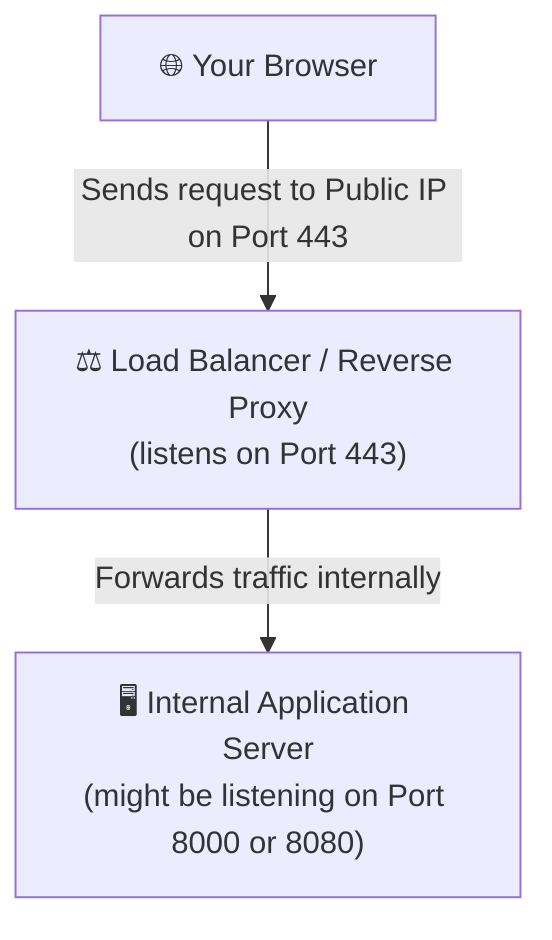

# IMP learnings while building this project

## Machine and PORT _(How actually port works in dev VS prod)_

### Development mode

We write `app.listen(8000)` while we building backend server. here we actually listening on this port `8000`. this ports is known as **TCP Ports**. when we do `http://localhost:8000` in browser, the browsers sends a request to that port which is listening for any incoming request, when that request recieves, we process the request according to what code we written. we send the response and browser show the response. this is all about development mode.

### Production mode

In prod, we usually deploy that same code above we discussed in prod. we have this VPS where we git clone the repo and run npm start. now our app (server) running on that vps machine on port which we specified in code, (maybe 8000 or 8080). here, it is completely different environment because our vps is open and connected to public internet. any one with our vps public IP address `142.250.190.46:8000` can access our app.

**Now the doubt was, how do users/browsers knows where my backend code is running and on which port**

How your browser knows which port to hit ?

- When you type a URL, your browser looks at the very beginning of the address (the protocol):
- If you type **http://** app.com, your browser assumes the standard, unencrypted web port: Port 80.
- If you type **https://** app.com (which almost all websites use today), your browser assumes the secure, encrypted web port: Port 443.
  When you just type app.com and hit Enter, modern browsers automatically turn it into https://app.com. Behind the scenes, the browser takes app's IP address and attaches the default secure port, which is `443`.

So, your browser is actually making a connection to: `142.250.190.46:443` (secure port)

**So, do we need to start developing server and assigning port `443` or `80` while in dev mode and in prod??**

-> NO..

In Development (Your Laptop): You use ports like `3000`, `5000`, or `8080` because ports `80` and `443` are usually restricted by your computer's OS for security, or you just want to avoid conflicts with other system services.

In Production (Render/VPS): You let the platform or a reverse proxy **(like Nginx)** listen on the standard public ports `(80/443)`, which then quietly routes the traffic to whatever internal port (process.env.PORT) your app is listening on.

### A Flowchart of how it all works

